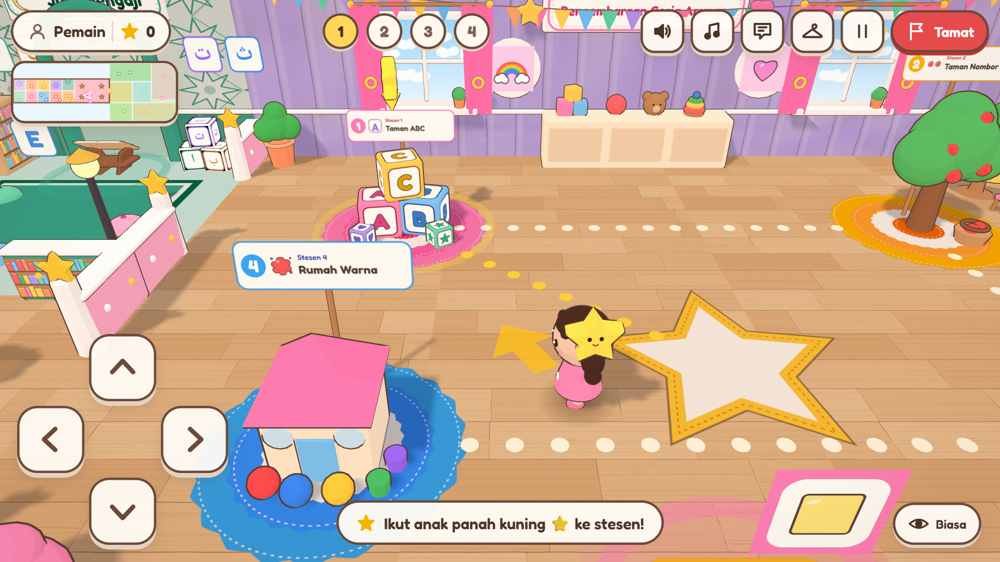
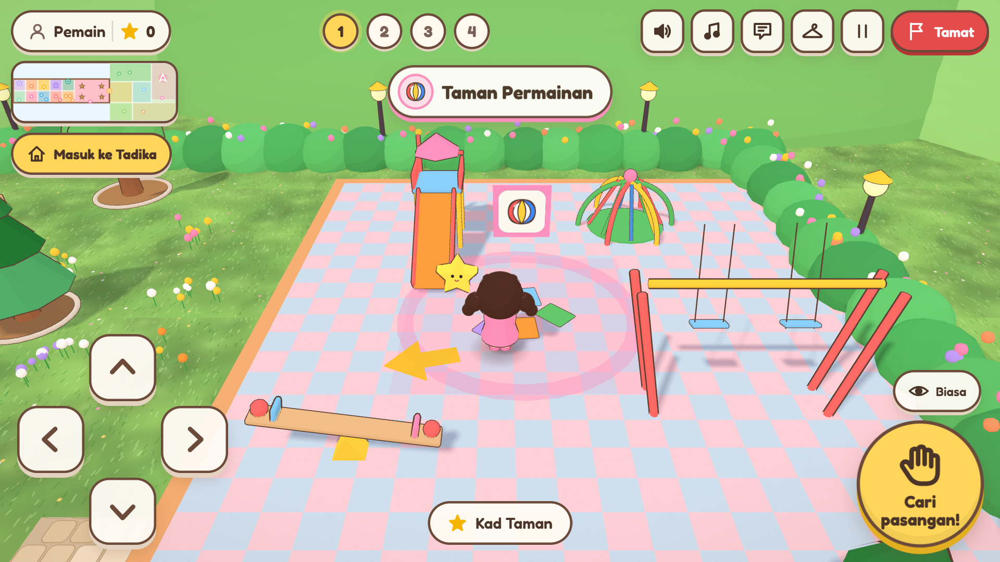
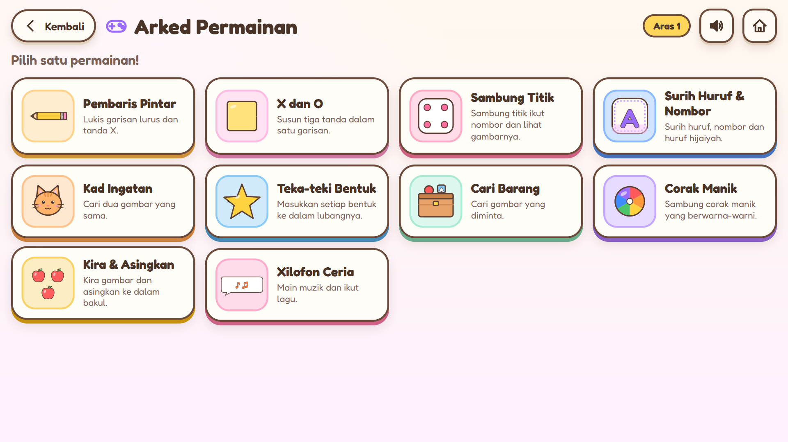
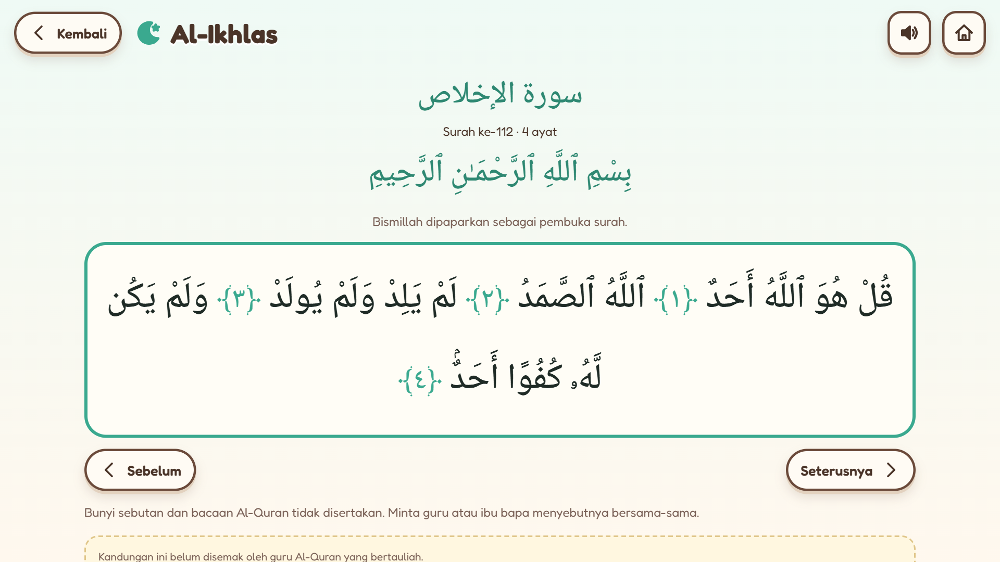
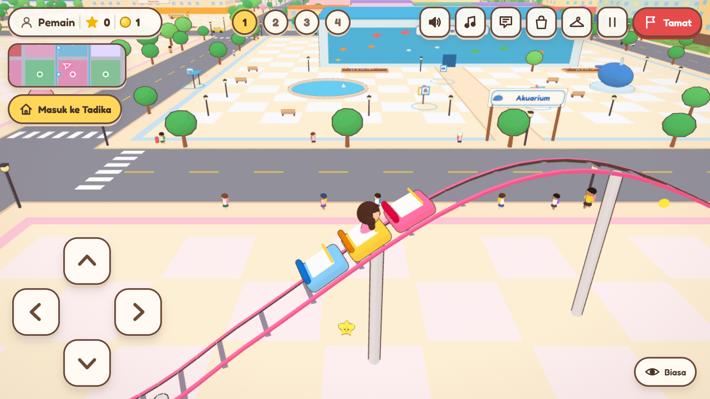
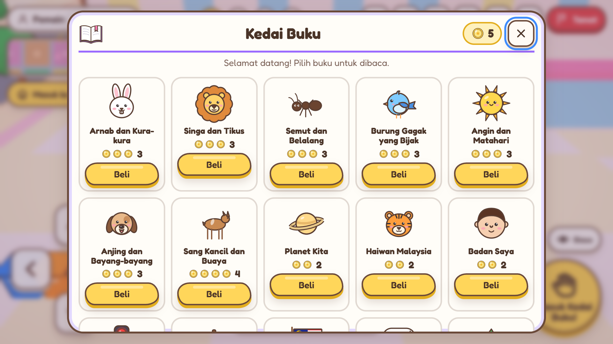
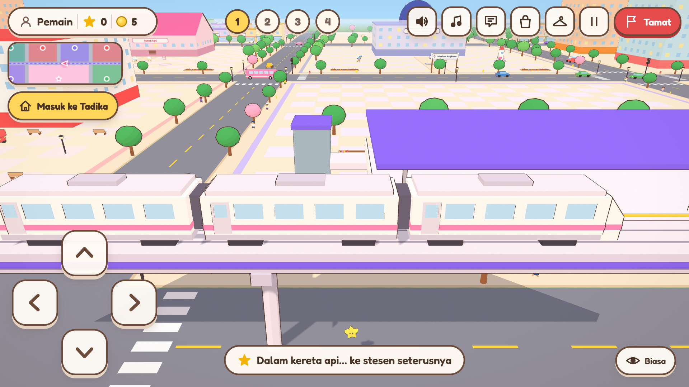
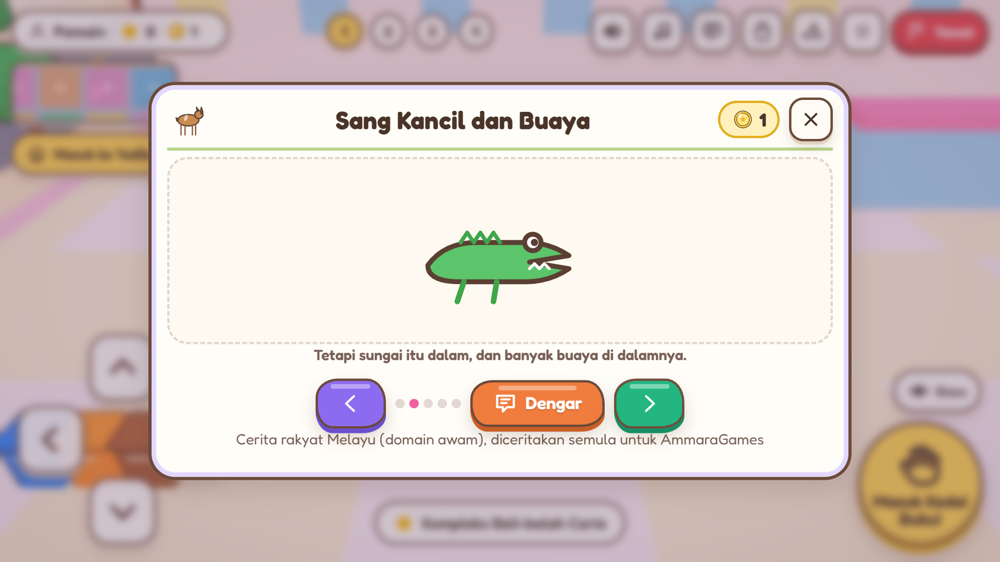
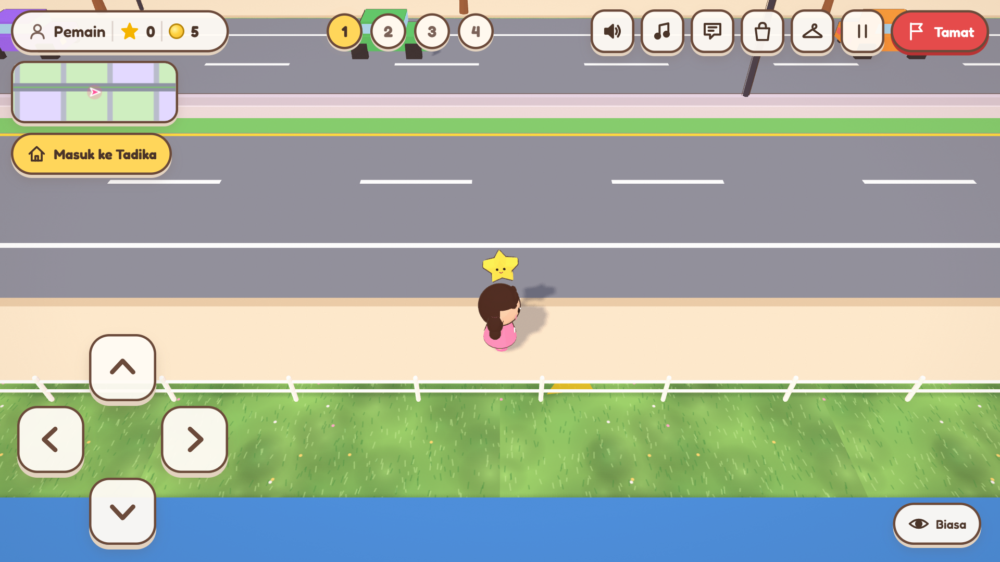
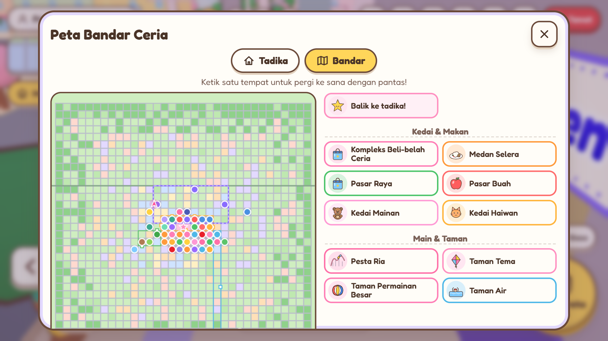

<div align="center">

# AmmaraGames

**Langkah Kecil, Penemuan Besar! · Little Steps, Big Discoveries!**

An offline 3D learning world for preschool children aged 2 to 4+:
a whole preschool and garden inside a big, busy, friendly town (unicorns, toy cars, buses, a highway, an elevated train, a roller coaster,
shops that take coins, picture books read aloud, and more than 50 things to see and do),
16 learning worlds, a 10-game arcade and a gentle *Jom Mengaji* Quran-learning corner.
Bahasa Melayu first, English one tap away.


 

</div>

---

## Contents

1. [Highlights](#highlights)
2. [Quick start](#quick-start)
3. [The world](#the-world)
4. [The town: Bandar Ceria](#the-town-bandar-ceria)
5. [Mini-Game Arcade](#mini-game-arcade)
6. [Jom Mengaji](#jom-mengaji)
7. [Narrator, music and sound](#narrator-music-and-sound)
8. [For teachers and parents](#for-teachers-and-parents)
9. [Privacy and safety](#privacy-and-safety)
10. [Deployment](#deployment)
11. [Development](#development)
12. [Quality and testing](#quality-and-testing)
13. [Known limitations](#known-limitations)
14. [Credits and licences](#credits-and-licences)

## Highlights

| | |
|---|---|
| **One file, no internet** | The whole game, including 3D engine, fonts, pictures, books and music, is `AmmaraGames.html` (about 1.9 MB). Double-click to play. |
| **Big 3D preschool + garden** | 11 indoor corners and 6 garden areas (120 × 44 m), with a front door, playground, sandpit, hopscotch, flower garden and a gazebo Nature Station. |
| **A whole town around it** | *Bandar Ceria*: 4.2 × 4.2 km, about 7,000 buildings, 48 places to visit, a funfair with a roller coaster, 8 shops that take coins, 21 picture books read aloud, 145 "Did you know?" boards, traffic lights, buses, a highway and an elevated train. |
| **16 learning worlds + town quizzes, 513 questions** | Letters, numbers, colours, shapes, animals, fruit, vehicles, body, nature, space, hygiene, safety, feelings, patterns and more, in BM and English, chosen by age group. |
| **10 mini-games** | Ruler & straight lines, X and O, connect the dots, trace letters/numbers/Hijaiyah, memory cards, shape puzzle, find it, bead patterns, count & sort, xylophone. |
| **Jom Mengaji** | 28 Hijaiyah letters, original exercises, and 20 short surahs with verbatim Tanzil Uthmani text and an embedded Arabic font. |
| **Friendly helpers** | A star mascot, two seated robot friends who say hello, and an optional narrator voice. |
| **No pressure** | No timers, no lives, no failure screens. Mistakes are free; every effort gets encouragement. |
| **Kid Lock + installable app** | Full screen, ghost-touch filter, no accidental refresh or zoom, resume after reload; installs from the browser and works offline. |
| **For classrooms** | Class lists on one shared laptop, per-child progress, CSV export, adult-only teacher area. |

<div align="center">
 
</div>

## Quick start

1. Download **`AmmaraGames.html`** (repository root, or `dist/AmmaraGames.html`).
2. **Double-click it.** It opens in Chrome or Edge. No installation, account or internet.
3. Press **MAIN / PLAY**. Move with the arrow keys, W-A-S-D, the on-screen arrows, or tap the floor to walk there.
4. Walk to a glowing station or a place with a coloured ring, then press the big yellow button (or Enter / E).

Tip: press **F11** for full screen on a classroom projector. Sound starts after the first tap (a browser rule).

If 3D graphics are not available, the game says so and offers **card mode** with the same questions.

## The world

* **Main hall:** the four learning stations of the chosen world, an X and O floor mat, and the front door.
* **West wing corners:** Jom Mengaji, ABC & Reading (with the robot friends Robo Danial and Robo Aisyah), Mini-Game Arcade, Art, Numbers, Colours & Shapes, Animals, Music, Wardrobe & Rewards, and a cosy Rest corner.
* **Garden:** front gate and fountain, flower garden, playground (slide, swings, seesaw, climbing dome), sandpit, hopscotch lawn, picnic park with the Nature Station.
* **Never lost:** a minimap, a big map where you tap a place to walk there, "Back to start", a "Back into the Preschool" button outside, and an arrow that always points the way. The whole map is checked by a path-finding test, so there are no dead ends.

## The town: Bandar Ceria

Walk out of the garden gate and the preschool is in the middle of a busy, friendly town, built in the same soft toy style.

<div align="center">
 
 
 
</div>

* **Size:** 4.2 km × 4.2 km (17.6 km²), about half the 6 × 6 km map square of GTA San Andreas. Streets every 120 m, 1,054 blocks, about 7,000 buildings and 24,000 trees: shophouse streets, towers, flats, terrace houses, wooden village houses on stilts, parks, a little forest, green hills and a beach with the sea.
* **48 places to visit**, each with something to do, listed in groups on the town map:

| Group | Places |
|---|---|
| Shops & food | Shopping Centre (bookshop, sweet shop, boutique, toy shop), Food Court, Supermarket, Fruit Market, Toy Shop, Pet Shop |
| Play & parks | Funfair (roller coaster, bumper cars, drop tower, carousel), Theme Park (Ferris wheel), Big Playground, Water Park (slide, splash pad), Happy Zoo, Bird Park, Lake Park, Jogging Park, Sports Courts, Mini Stadium, Kite Park, Music Stage, Hibiscus Garden, Happy Farm |
| Learn & museums | Library, Science Centre, Space Museum, Dinosaur Museum (fossil dig), Aquarium, Butterfly Park, Art House, Primary School, Recycling Centre, Clock Tower Square (real time), Cinema (story time), Heritage Village, Wind Farm |
| Community & mosques | Grand Mosque (four minarets) and Mosque with Jom Mengaji, Hospital (with a dentist), Health Clinic, Fire Station, Police Station, Post Office, Savings Bank |
| Getting around | 4 train stations, Bus Station, Little Airport (a plane takes off), Jetty & Lighthouse |

### More than 50 things to see and do

**Getting around:** (1) ride a unicorn, (2) drive an open toy car (215 of them around town), (3) call a bus at one of 13 stops on 3 routes, (4) ride the elevated train between 4 stations, (5) ride the roller coaster up the lift hill and down, (6) quick trips with the town map, (7) "Back to the preschool" from anywhere.

**Coins and shops:** (8) gold coins to pick up on the pavements (3 per block), (9) coins for town quiz answers, (10) for reading a fact board and (11) for finishing a book; (12) 8 shops selling 73 things, priced 1 to 6 coins and shown as coins to count; (13) "not enough coins" is said kindly with what to do; (14) My Bag; (15) 21 picture books to buy and keep; (16) clothes and accessories from the boutique, worn at once; (17) balloons and a magic wand from the toy shop; (18) food from the food court, supermarket, sweet shop and funfair stall, each with a healthy tip when eaten; (19) pet food with a tip about caring for animals; (20) toys to play with.

**Reading and knowledge:** (21) 7 retold stories: Aesop's *Hare and Tortoise*, *Lion and Mouse*, *Ant and Grasshopper*, *Clever Crow*, *Wind and Sun*, *Dog and his Reflection*, and *Sang Kancil and the Crocodiles*; (22) 14 knowledge books (planets, animals of Malaysia, my body, road safety, Malaysian fruit, Malaysia my country, good manners, recycling, dinosaurs, sea life, telling the time, the butterfly's life cycle, people who help us, money and saving); (23) every page read aloud, in Malay or English; (24) 74 "Did you know?" facts on 145 boards around town; (25) 35 town quiz boards with 10 new topics: dinosaurs, sea life, money, time, recycling, community helpers, Malaysia, insects, healthy food and an active body (60 new questions, 513 in total); (26) the clock tower's real clock and a talking clock card; (27) story time at the cinema; (28) Jom Mengaji at both mosques.

**A busy town:** (29) traffic lights that change colour, where cars stop at red; (30) 36 town cars that keep left and stop for children; (31) a 4-lane highway with its own fast traffic; (32) 64 people on the pavements: school children in uniform and grown-ups, some in a tudung; (33) say hello and they answer; (34) joggers running round the jogging track; (35) shophouse streets with 40 different shop signs (Kedai Roti, Farmasi, Dobi, Kedai Batik…), five-foot ways and angle parking; (36) terrace houses with small yards, cars and a surau; (37) wooden village houses on stilts among coconut palms; (38) street trees, fire hydrants, post boxes, recycling bins, benches, garden lamps and flower beds.

**Things that move:** (39) bumper cars, (40) the drop tower, (41) the carousel, (42) the Ferris wheel, (43) butterflies in the greenhouse, (44) birds in the aviary, (45) cats, a dog and rabbits in the pet shop pen, (46) kites flying in the kite park, (47) wind turbines turning, (48) a plane taking off at the airport, (49) the lighthouse beam, (50) boats at the jetty and out at sea, (51) water jets in the splash pad, (52) dinosaur statues, a whale statue, a giant piggy bank and a hornbill.

**Never lost, always safe:** (53) the corner map shows the streets around the child; (54) every area shows its name and has its own music; (55) the follow camera never looks through a building, the train deck or a platform; (56) only the part of town near the child is built (in 240 m squares), so it runs on a school laptop.

## Mini-Game Arcade

Every game has the same simple frame: **Back · Help (with narration) · Restart · Sound · Home**, round stars, a celebration, and a sticker the first time it is finished. Difficulty follows the age group (2-3, 3-4, 4+). Each game can also be found at its place in the 3D world (for example the xylophone in the Music corner, the chalkboard outside).

| Game | What children practise |
|---|---|
| Clever Ruler | straight lines from dot to dot (with an optional ruler), X marks |
| X and O | turn-taking against a kind robot, or two players |
| Connect the Dots | number order 1, 2, 3… revealing a picture |
| Trace Letters & Numbers | A-Z, a-z, 0-9 and Hijaiyah letters |
| Memory Cards | visual memory with matching pairs |
| Shape Puzzle | shape recognition by drag-and-drop (or tap-tap) |
| Find It | visual search with themed baskets |
| Bead Patterns | AB, AAB, ABC patterns |
| Count & Sort | counting to 5/10/20 and sorting by colour or kind |
| Happy Xylophone | follow a song, copy a tune, or free play |

## Jom Mengaji

* **Huruf Hijaiyah:** all 28 letters with names, dot facts and look-alike families; exercises (match the letter, how many dots, which mark) and tracing.
* **Surah Pilihan:** 20 short surahs in the school's chosen order (Al-Fatihah, An-Nas, Al-Falaq … Al-'Alaq), with the real surah numbers.
* **Text integrity:** the Quran text is the Tanzil Uthmani text, copied **verbatim** and checked automatically against the source file on every test run (137 verses, byte for byte).
* **No computer recitation:** the narrator never reads Arabic, and no recitation audio is bundled (licences not confirmed), so there is no recitation Play button.
* **Review status:** the Islamic content has **not yet been reviewed by a qualified Quran teacher**. The app says so on every Jom Mengaji screen. The review checklist is in [`research/ISLAMIC-CONTENT-REVIEW.md`](research/ISLAMIC-CONTENT-REVIEW.md).

## Narrator, music and sound

* **Narrator:** uses the voices already installed on the computer, offline only. It prefers the child's language and voices whose names usually belong to female voices, with a slightly lighter default pitch. In **Voice & Sound** you can listen to each voice, pick one, and set speed, pitch (within a natural range) and volume. If no voice exists for a language, the app says so honestly and shows the text instead.
* **Music:** synthesised live with Web Audio: cheerful playroom, garden with birdsong, chiptune arcade, a quiet calm profile for Jom Mengaji, and a reward tune. Tracks fade, never overlap, and duck while the narrator speaks.
* **Separate volumes** for music, sound effects and narrator, plus one-tap mute everywhere.

## For teachers and parents

Hold the **Cikgu / Ibu Bapa** button for 1.5 s to open the teacher area.

* **Class list:** type one first name per line; children take turns on one laptop, and the game moves to the next child at the end.
* **Progress:** per child and per station: attempts, first-try results, stars, rewards.
* **CSV export:** the station records (18 columns, unchanged since 1.0) and a separate **activity file** for mini-games, Jom Mengaji and free questions (13 columns). UTF-8 with BOM for Excel, protected against spreadsheet formula injection.
* **Customise without programming:** open `AmmaraGames.html` in Notepad or VS Code and edit the `AMMARA_CONFIG` block near the top (game title, character, colours, questions, rewards, timings). A built-in checker skips anything broken and lists it under Teacher > Info.

## Privacy and safety

* No network code: no accounts, analytics, adverts, telemetry or external links. The end-to-end tests block and count every network request (zero).
* Names and results stay in this browser's local storage on this computer. Clearing site data or a private window removes them; download the CSV after lessons.
* Use first names or nicknames only. **Delete all data** (two confirmations) is in the teacher area.

## Deployment

The build produces two things:

| Output | What it is | Use it for |
|---|---|---|
| `AmmaraGames.html` (also `dist/AmmaraGames.html`) | the whole game in one file | double-click on a classroom laptop, USB stick |
| `dist/` (`index.html`, `manifest.webmanifest`, `sw.js`, `icons/`) | the **installable web app (PWA)**: opens full screen with no address bar, works offline after the first visit, has a fixed address so saved progress stays put | phones, tablets, school computers, GitHub Pages |

### Publish on GitHub Pages (live link)

1. In the repository: **Settings > Pages > Build and deployment > Source: GitHub Actions** (one time).
2. Push to `main`. The workflow `.github/workflows/pages.yml` installs, runs the unit tests, builds, and publishes `dist/`.
3. The game is live at **https://fildxza.github.io/AmmaraLearningGames/**.

Any other static host works the same way: upload the contents of `dist/` (no server code, no environment variables). It must be served over **HTTPS** for installing and offline use.

### Install as an app

* **Android (Chrome/Edge):** open the link, menu > *Install app* / *Add to Home screen*.
* **iPad / iPhone (Safari):** Share > *Add to Home Screen*.
* **Windows / Mac (Chrome/Edge):** the install icon in the address bar, or Teacher > Settings > *Install as an app*.

The installed app opens in full screen. After the first visit it works with no internet; a new version is picked up the next time it is opened with internet.

### Kid Lock (on by default; Teacher > Settings turns it off)

Built to stop small hands from leaving the game by accident:

* full screen from the first tap (re-entered after an accidental exit); Esc is held back so a tap cannot leave full screen on desktop Chrome/Edge;
* **ghost-touch filter:** touches on the very edge of the screen, palm-sized touches, 4+ fingers at once and double-fast taps are ignored;
* no pinch zoom, no long-press menu, no pull-to-refresh; F5, Ctrl+R, Ctrl+P, Ctrl+S, Ctrl+U and browser zoom shortcuts are blocked;
* the device **Back** button/gesture does not leave the page (it works like the game's own Back);
* a "leave this page?" warning while a lesson is on screen, and the screen stays awake;
* **resume after reload:** if the page is refreshed or closed by accident, it opens again in the same place (same corner, same child, same game screen) for up to 6 hours. Pressing Home on purpose clears this.

**What a web page cannot block:** Alt+F4, Ctrl+W, and the device's own home / recent-apps buttons. For a real lock, combine the installed app with the device's built-in child mode:

| Device | Setting |
|---|---|
| Android tablet/phone | *Screen pinning* (Settings > Security; then pin the app from Recent apps) |
| iPad | *Guided Access* (Settings > Accessibility; triple-press the side button) |
| Windows laptop | *Assigned access / kiosk mode* with Edge in kiosk mode, e.g. `msedge --kiosk https://fildxza.github.io/AmmaraLearningGames/ --edge-kiosk-type=fullscreen` |

A native Android package (Trusted Web Activity / Capacitor) and a Windows `.exe` (Tauri) can wrap this same web app later if a school needs them; see `research/UPGRADE-RESEARCH-REPORT.md`.

## Development

Requirements: Node.js 20+ and Chrome or Edge (for the browser tests).

```bash
npm install
npm run build            # writes AmmaraGames.html + dist/AmmaraGames.html, fails on network-looking code
npm test                 # unit tests (rules, records, layout, narrator, Quran text, icons)
npm run e2e              # original 41 end-to-end checks in Chrome   (npm run e2e:edge for Edge)
npm run e2e:upgrade      # 13 checks for the 3D world, narrator, arcade, Jom Mengaji (…:edge for Edge)
npm run e2e:lock         # 9 checks for Kid Lock, resume after reload, offline web app over http (…:edge for Edge)
npm run e2e:city         # 23 checks for the town: rides (unicorn, car, bus, train, roller coaster), coins, shops, books, facts, traffic lights (…:edge)
npm run city-tour        # screenshots of town places (landmarks, stations, highway, beach…)
npm run icons:app        # re-renders the app icons in public/icons from the star mascot
npm run play-games       # plays all ten mini-games with real mouse input and saves screenshots
npm run tour             # screenshots of every corner of the 3D world
npm run report           # regenerates TEST-REPORT.md from the last results
npm run preview          # local server on http://127.0.0.1:5500/
```

### Project structure

```
public/                     manifest, service-worker template, app icons (copied into dist/)
src/
  config/game-config.js     teacher-editable content: worlds, stations, questions, rewards, settings
  data/                     quran-data.js (generated from Tanzil), hijaiyah.js
  engine/
    core/                   validator, progress & CSV, collision, A* navigation grid (no browser needed)
    world/                  Three.js world: layout (single source of truth), building, zones, yard, NPCs, stations
    city/                   the town: plan.js + landmarks2.js (pure data: streets, blocks, 48 places, buses, highway, train line,
                            coins, fact boards), build.js + build2.js + props2.js (streamed 3D squares), life.js (traffic, people,
                            buses, highway cars, trains), signatlas.js (shop signs)
  data/books.js, facts.js, shops.js   picture books (retold public-domain stories + our own knowledge books), facts, shop catalogues
    minigames/              logic.js (pure, unit-tested rules) + the ten game screens
    ui/                     menus, HUD, map, voice & sound panel, arcade frame, Jom Mengaji
    narrator.js, audio.js   offline voice service, synthesised music and effects
    kidlock.js, pwa.js      accidental-exit protection, installable offline web app
    game.js                 state machine (MAIN_MENU, PLAYROOM, QUIZ, ARCADE, MINIGAME, ISLAMIC, …)
  styles/                   main.css, upgrade.css, games.css
tests/unit, tests/e2e       Node unit tests and puppeteer browser tests
tools/                      build, tours, performance, report
research/                   content research, Islamic content review, asset manifest, upgrade report
licenses/                   third-party licences
```

## Quality and testing

See [`TEST-REPORT.md`](TEST-REPORT.md) (generated from the real runs, not typed by hand) and [`research/UPGRADE-RESEARCH-REPORT.md`](research/UPGRADE-RESEARCH-REPORT.md).

What is verified automatically: game rules, records and CSV, reachability of every place on the map, collisions, all ten games played to the end, Quran text identical to the source, narrator voice choice (with a stub speech engine), offline operation, no console errors, and layouts at phone, tablet and projector sizes, in Chrome and Edge. For the town: every building and collider stays inside its lot, nothing blocks a learning place, ride or bus stop, bus routes and the train line follow the streets, train pillars stay out of crossings and traffic lanes, and real rides on a unicorn, a car, the bus and the train (to the next station and off again) in the browser. Every picture the game can show (513, including every page of every book, every shop item and every shop sign) is rendered and checked for empty boxes. Shopping (coins, buying, owning, eating), books and fact-board coins are unit-tested, and a real child-like session buys a book, reads it aloud to the end, buys clothes and a lollipop, reads a fact board and rides the roller coaster in Chrome and Edge.

What is **not** verified: how the narrator voice actually sounds on your computer (nobody listened to it), the music on real speakers, physical touch screens, other browsers, slow school laptops, real children aged 2-4, and review by a qualified Quran teacher.

## Known limitations

* The narrator depends on the voices installed on the computer; many computers have no offline Malay voice (the app then uses Indonesian if present, and says so, or shows text only).
* Weak graphics chips may run the big world slowly; the game then lowers its graphics quality automatically (Teacher > Settings > Graphics also has a Light mode).
* Tracing checks the shape, not the stroke order. Hijaiyah letter names have no audio.
* In the town, buses do not wait at traffic lights (cars do). Getting on the train, bus or roller coaster is shown as a jump into the seat (no walking up stairs). Between tall towers the camera view can be narrow. Things high in the sky are not visible from the game camera, so the town is busy at street level.
* Records are per browser and per file location.

## Credits and licences

* Fredoka font: The Fredoka Project Authors, SIL Open Font License 1.1.
* Noto Naskh Arabic font: The Noto Project Authors, SIL Open Font License 1.1.
* Quran text: Tanzil Project (tanzil.net), Uthmani text, Creative Commons Attribution 3.0, used verbatim.
* Three.js: MIT licence.
* Picture-book stories: Aesop's Fables (ancient Greece, public domain) and the Malay folk tale of Sang Kancil (traditional, public domain), retold in our own words. The knowledge books and the "Did you know?" facts are original text written for this project.
* Everything else (3D world, characters, pictures, music, sounds) was created for this project. See [`research/ASSET-MANIFEST.md`](research/ASSET-MANIFEST.md) and [`licenses/`](licenses/).

Project code and original artwork: **MIT License**, © 2026 Mohamad Fildza bin Azman (see [`LICENSE`](LICENSE)). Third-party parts keep their own licences listed above.
